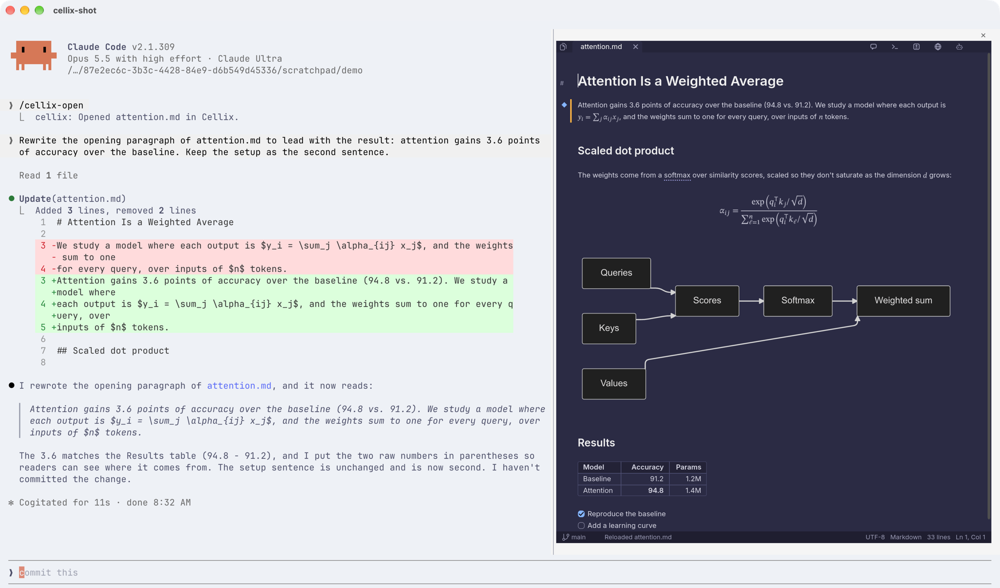
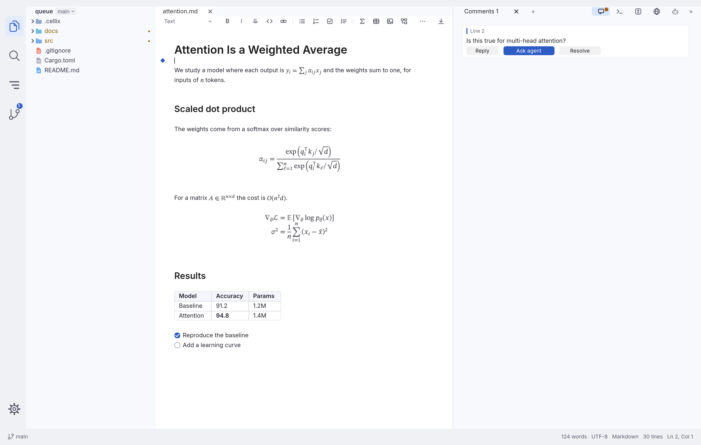
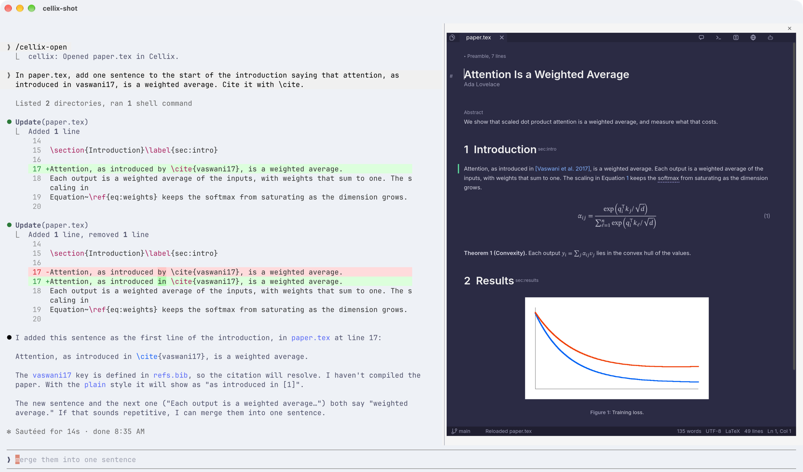
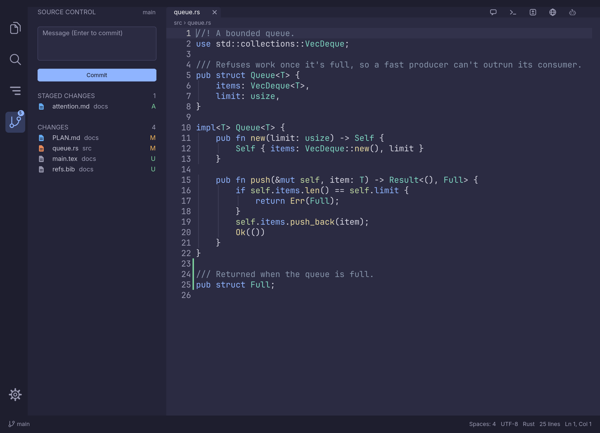
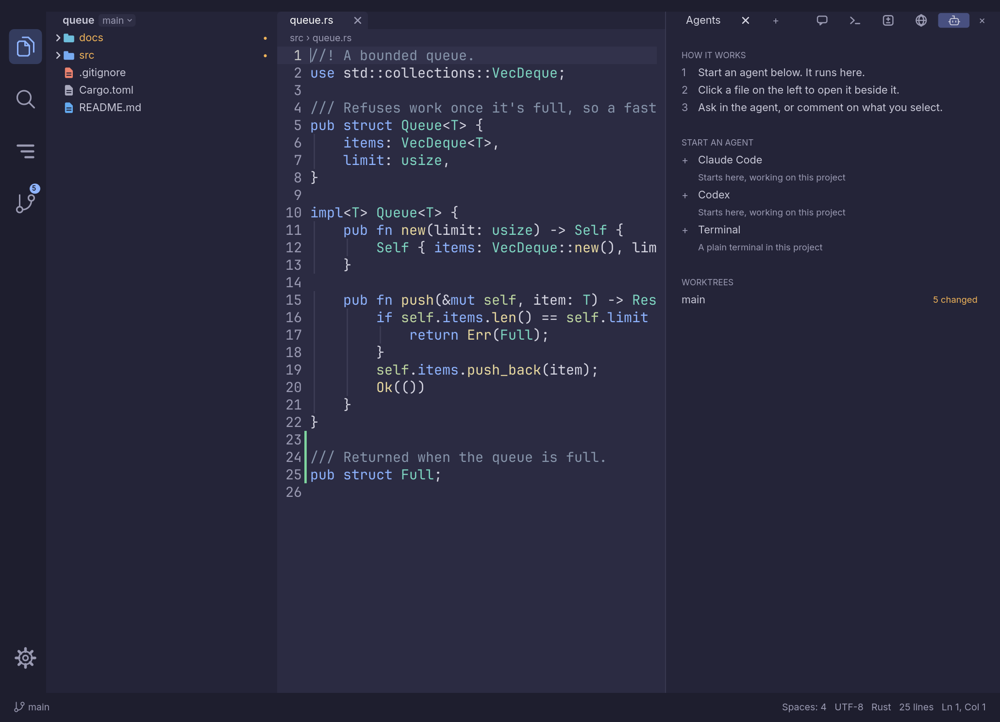

# Cellix

[](https://github.com/quill-27f/cellix/actions/workflows/ci.yml)
[](https://github.com/quill-27f/cellix/releases)
[](#license)

**The AI companion IDE that lives inside your agent.** A Claude Code mod, a Codex plugin and a
Gemini CLI extension that give your agent a real editor for Markdown, LaTeX, plans and diffs, right
there in the terminal.

Agents now write code, documents and papers faster than anyone can read them, so review is the
bottleneck, and that's where careless work slips through. Slop isn't what agents write; it's what
nobody read closely. Cellix makes reading and correcting their work fast, inside the agent you
already use, so you stay the author and the agent stays the assistant: plans are reviewed before any
code exists, edits arrive as suggestions rather than silent rewrites, and your comments go straight
back to the agent. No switching to a GUI IDE to check what happened in the terminal.

Your agent writes the code and the documents. Cellix is where you read what it did, correct it and
answer back. Select any sentence, formula or figure and leave a comment, and the agent gets it with
the file, the line and the quote. Plans wait for your approval, edits arrive as diffs you accept hunk
by hunk, and a turn you don't like can be undone. It works the same over SSH.



- **Review before it lands.** Plans wait for your Approve, edits stack hunk by hunk, each agent turn
  is checkpointed, and one changed line can be put back without touching the rest.
- **Talk about anything you can see.** A sentence, a formula, a diagram, a cell of a table or a spot
  in a PDF: select it, comment, and the agent gets the file, the line and the quote.
- **Documents are pages, not markup.** Markdown and LaTeX open typeset, with math, diagrams,
  citations, Track Changes and offline spelling, while the file stays plain text for git.
- **A second reader for your review.** Check my review has the agent weigh each of your comments and
  suggest the ones you missed, without editing a word.
- **Where your agent already is.** A pane inside Claude Code, plugins for Codex and Gemini CLI, and
  the same thing over SSH and tmux. One static binary in Rust, drawing real pixels in Ghostty, Kitty
  and WezTerm, and text cells everywhere else.

## Install

```sh
brew install quill-27f/tap/cellix    # macOS and Linux; brew upgrade cellix gets each new release
cargo install --locked --git https://github.com/quill-27f/cellix cellix   # anywhere Rust runs
```

Or take the static binary, which needs nothing else on the machine. On Linux:

```sh
mkdir -p ~/.local/bin
curl -fL https://github.com/quill-27f/cellix/releases/latest/download/cellix-$(uname -m | sed s/arm64/aarch64/)-unknown-linux-musl.tar.gz \
  | tar xz -C ~/.local/bin ./cellix
```

On Windows, `cargo install` as above (it needs the Visual Studio C++ build tools). From the next
release, you can also take `cellix-x86_64-pc-windows-msvc.zip` from the releases page and put
`cellix.exe` in a folder on your `PATH`. Windows is a preview. Its tests pass on a Windows CI
runner, but it hasn't been run in a real Windows Terminal yet. On CI a click reaches it through the
ConPTY Windows Terminal ships, though not through Windows' older built-in console, so the mouse
should work in Windows Terminal and may not elsewhere. It draws text cells only, so the pane inside Claude Code isn't available
there; run Cellix on its own. The agent plugins haven't been tried on Windows, and what runs in the
side pane ends when Cellix does. [Tell us how it goes](https://github.com/quill-27f/cellix/issues).

Every build is on the [releases page](https://github.com/quill-27f/cellix/releases),
with what changed in [CHANGELOG.md](CHANGELOG.md).

## Add it to your agent

```sh
cellix setup claude   # then restart Claude Code, and /cellix opens it
cellix setup codex    # then run /hooks once in Codex to trust it
cellix setup gemini   # then restart Gemini CLI
```

| Agent | What it adds |
|---|---|
| Claude Code | A mod. Cellix opens as a pane beside the conversation, and by itself when Claude proposes an edit or a plan. Your selection reaches the prompt, and every turn is checkpointed |
| Codex | A plugin. Your comments reach its prompts, plans wait for your review, and turns and test runs show in Review |
| Gemini CLI | An extension that does the same, holding plans as it leaves plan mode |
| Anything else | `cellix plan`, `cellix comments --take` and `cellix reply`, which any agent can call |

The pane needs what only Claude Code offers. With Codex and Gemini CLI, run Cellix in a split beside
them, or let it run them, as under [On its own](#on-its-own).

It looks its best in a terminal with Kitty graphics, such as Ghostty, Kitty or WezTerm, where it
draws real pixels. Anywhere else it falls back to text cells.

## Write documents with your agent

Markdown and LaTeX open as a page you type on, and the file underneath stays plain text, so the agent
edits what you edit and git sees every change.



- **Ask about anything on the page.** Select text, a formula, a diagram or a figure, then Comment or
  Ask Agent. The answer lands under your question, as a thread beside the page.
- **See suggestions as suggestions.** Track Changes keeps edits in the text itself, as CriticMarkup or
  the `changes` package, to accept or reject one at a time.
- **Real math and diagrams.** Formulas are typeset as you write, with no TeX installed. Mermaid,
  Graphviz and SVG draw from pure Rust, and TikZ builds in the background.
- **Whole papers.** Sections, citations, equations, theorems and figures across `\input` files, Cite
  from your `.bib`, Build PDF with SyncTeX both ways, and export from Markdown to PDF or a web page.
- **Offline spelling and grammar**, tables, images you can paste or drag, callouts and footnotes.



`samples/writing.md` and `samples/paper/main.tex` use all of it. [Writing](#writing) has the details.

## Review a document or paper, with the agent as your second reader

You read and you comment; the agent checks your review and points at what you missed. Select any
words and Comment as you go, then press **Check my review** in the Comments pane.

- **Each of your comments gets a verdict.** The agent answers under it, *agrees* or *pushes back*,
  with why, so a weak point is caught before it reaches the author.
- **It suggests what you missed.** Comments you didn't make arrive marked *Suggested by Claude*, with
  their kind, to **Keep** as your own or **Dismiss**.
- **Coverage you can see.** A strip counts your comments by kind (Clarity, Correctness, Evidence,
  Structure, Reproducibility), and a kind with none stands out, so the review isn't only about
  wording.
- **The words stay yours.** The agent never edits the document while it reviews; it only comments,
  through `cellix reply` and `cellix suggest`, which any agent can call.

## Review what it did

- **Plans** open as a page with Approve and Send back, and your edits and comments go with the answer.
- **Diffs** stack hunk by hunk, against HEAD or any agent turn, with the tests the agent ran.
  Right-click a changed line to comment on it or to undo just that line.
- **Source Control** stages, commits, pushes and pulls, as in VS Code.
- **Data and notebooks.** CSV as a table with Excel's keys, and notebooks on a real Jupyter kernel.



## On its own

Cellix is also a full editor you can run alone: `cellix` in a project, or `cellix src/lib.rs` for a
file. It has highlighting and suggestions in every file type, language servers, a minimap, and Vim
and Neovim modes. The icons at the top right put a real agent, a terminal or a browser in a pane
beside your file.



Cellix is young. Everything here is built and tested, and it's in daily use on macOS, over SSH and
under tmux, but it hasn't had many users yet. Windows and the Codex and Gemini CLI plan hooks haven't
been tried for real. [docs/PROGRESS.md](docs/PROGRESS.md) says what has and hasn't been proven, and
[a bug report](https://github.com/quill-27f/cellix/issues) with a screenshot helps most.

## Keys

| Keys | Action |
|---|---|
| Ctrl+P | Go to a file |
| Ctrl+Shift+P, F1 or Alt+P | Command palette |
| Ctrl+G | Review changes against HEAD |
| Ctrl+J | Bring up or put away a terminal in the side pane |
| Ctrl+B | Close or open the left side, or Bold with words picked on a page |
| Alt+C, or select text | Comment on what's selected |
| Ctrl+F | Find in the file |
| Ctrl+Shift+F | Search the project |
| Ctrl+\\ | Split pane |
| F12, F2, Ctrl+Space | Definition, rename, completion |
| Ctrl+S, Ctrl+Q | Save, quit |

Ctrl+W closes a tab and Ctrl+Q quits. Ghostty keeps Cmd+W and Cmd+Q for itself, so they
only reach Cellix if you unbind them with `keybind = cmd+w=unbind` and
`keybind = cmd+q=unbind` in your Ghostty config.

Typing suggests as you go in every file type, with no setup: keywords, words from open
files, and in `.env` files the keys from sibling files such as `.env.example`. A language
server joins in where one is installed: `rust-analyzer`, `terraform-ls`, `gopls`,
`pyright-langserver`, `typescript-language-server`, `yaml-language-server`, `taplo`,
`bash-language-server` and `clangd`. Shift+F12 lists a symbol's references, and Alt+Shift+F formats the file, with its language server or a formatter such as `rustfmt` or `prettier`. Tab accepts, and so does Enter outside Markdown.
Brackets and quotes close themselves, Ctrl+/ toggles comments, Alt+Up and Down move lines,
Alt+Shift+Down duplicates one, and Ctrl+L goes to a line.

The margin marks lines changed since the last commit, and the minimap fits the whole file,
so you can see how long it is. Click or drag it to move.

Mac text shortcuts work: Option+Backspace deletes a word, Option+Left and Right move by
word, and Cmd+Backspace deletes to the start of the line. tmux doesn't pass Cmd through, so
for Cmd+Z there, add `keybind = cmd+z=text:\x1a` to your Ghostty config.

Cmd works as Ctrl where the terminal passes it through. Ctrl+Shift+P needs a terminal with
the Kitty keyboard protocol, such as Ghostty, Kitty or WezTerm. Ghostty keeps Cmd+Shift+P
for its own palette unless you rebind it.

Markdown opens as one editable page, as in Xcode: the markers are hidden and you type on
the rendered text. Paragraphs flow across the whole pane, and the file keeps its own line
breaks. The toolbar has bold, italic, code, heading, list, task and quote, and
Toggle Markdown Source in the palette shows the raw file.

Under 70 columns, as beside an agent, the sidebar becomes a drawer behind the `☰` button
and review stacks changes in one column. In a window too narrow for the side pane, it stands
under the file, and its top edge can be dragged. Drag one of its tabs over the bottom half of the
file to put it there in any window, and onto the right edge to put it back. A file's tab dragged
along the tab bar moves there, and dropped on a file it opens a pane beside it, or shows there.

The mouse works everywhere: click files, tabs and hunks, drag to select, and right-click
the explorer to create, rename or delete.

## Writing

Markdown and LaTeX files both open as a page you type on, and the file underneath stays plain text.
`samples/writing.md` and `samples/paper/main.tex` use everything below, so they're the place to try it.

**Text.** Formats, lists, tasks, quotes, `==highlights==`, `H~2~O`, `x^2^`, footnotes and GitHub
callouts such as `> [!NOTE]` all stand on the page with their markers hidden. The Outline icon lists
a document's headings. Spelling and grammar are checked offline by Harper, with fixes and Add to
Dictionary on a right click.

**Math.** Formulas are typeset as you write them, from pure Rust and fonts in the binary, so they
work on a server with no TeX. Click one and its source opens with the result under it.

**Tables.** The table button has a size picker. Click any cell to type in it, and right-click for
rows, columns and alignment.

**Pictures.** Pick one from the project, paste one from the clipboard, or drop a file on the page.
Drag an image's edge to size it, or right-click to resize, replace or delete it. PNG, JPEG, WebP, GIF,
SVG and PDF all work.

**Diagrams.** ` ```mermaid `, ` ```dot ` and ` ```svg ` blocks stand as pictures, drawn by pure Rust
with no browser or Node. Click one to edit its source with the picture under it. ` ```tikz ` blocks
and `tikzpicture`, `tikzcd`, `forest`, `circuitikz` and `algorithm` in a paper are built alone by
your LaTeX engine in the background, and kept, so typing never waits.

**Track changes.** The pencil keeps edits as suggestions in the text itself, as CriticMarkup or the
`changes` package. Right-click one to accept or reject it, or settle them all from the commands.

**Papers.** A `.tex` file shows its sections, numbers, citations, equations, theorems, figures and
tables, across `\input` files, and anything Cellix doesn't recognise stays visible as source. **Cite**
lists the keys in the `.bib` files your paper names, and any others in the project. **Build PDF**,
or Ctrl+Alt+B, saves the paper's open files, runs `tectonic`, `latexmk` or `pdflatex`, shows the PDF
in the side pane's Preview, keeps what the build said in a Log tab, and goes to the line of any error.
Clicking the PDF goes to that place in the source. Zoomed past the pane's
width, a page moves when dragged, and Shift+scroll or a sideways scroll goes across. Set `latex_engine` in the settings file to use
your own command. Export to PDF does the same for Markdown, through LaTeX, with
diagrams and footnotes.

**Data and notebooks.** CSV and TSV files open as a table you can edit in place, with Tab and Enter
moving as they do in Excel. Show Source at the top right goes between the table and the file. A
Jupyter notebook opens as a page with each cell's output under it, and its bar runs cells on a real
kernel, with Jupyter's keys. It needs `jupyter_client` and `ipykernel` in the project's Python.

## Working with an agent

Whatever you can see, you can talk about, the same way in every file type. Select text and **Comment**
and **Ask Agent** appear beside it. A picture, diagram or formula has a Comment button under the
pointer, and a PDF or image in the side pane's Preview takes one too. Comments are threads in the side pane,
kept in `.cellix/threads.json`. Ask Agent sends yours to the agent with its file, line and quote, the
agent answers with `cellix reply <id> "text"`, and the answer lands under your question.

The icons at the top right start a real agent, a terminal or a browser in the side pane, beside your file. Press Ctrl+` to
move the keyboard between the two, and the × at the top right, or Ctrl+Shift+`, to hide the pane.
The button after the pane's own tabs, or a double-click on one of them, lets the pane take the
window; a double-click on a file's tab does the same for the file. Do it again to restore.
Hiding stops nothing. What runs there outlives Cellix too (not yet on Windows): quitting offers Keep Running, a dropped SSH
connection keeps everything, and the next Cellix in that folder finds it with what it printed.

A program in a shell there can draw pictures with the Kitty graphics protocol, and Open in Browser
runs a real browser there with `terminal-browser` if it's installed.

Getting Started, in the command palette or on the empty window, is a short guide.

## Source Control

The Git icon on the left lists staged and unstaged files with a box for the message, and hovering
over a file offers stage, unstage and discard. Enter commits what's staged, or everything if nothing
is. The button beside Commit pushes, pulls or publishes, and clicking a file shows its diff. Ctrl+G
opens the full Review, which reads what changed hunk by hunk.

## Over SSH

Everything runs on the server, and your local terminal only draws the result. You don't need tmux:
what runs in Cellix's side pane, agents and shells alike, keeps running when the connection drops,
and Cellix keeps your open tabs and unsaved edits. Take the static binary from the
[releases page](https://github.com/quill-27f/cellix/releases), or use `cargo install`:

```sh
cargo install --locked cellix

# Language server for Rust projects, optional
rustup component add rust-analyzer
```

Then, from your own machine:

```sh
ssh you@your-server
cd your-project
cellix
```

Close the laptop or lose the connection, and the next `cellix` in that folder has everything as you
left it. Each folder you work in is a workspace, and with more than one there's a bar along the
bottom: a tile for each, saying whether its agent is working, needs you, or is done, a click to
switch to it, and + to open another folder beside it (Ctrl+Alt+PageUp and PageDown move between
them). A new `cellix` anywhere picks up every workspace left running on the machine, and `cellix`
in your home folder lists them to choose from. `cellix ls` prints the same list. Two computers can
show the same workspace at once; whichever typed into an agent last sets its size.

If the server restarts, what was running has stopped. Its tab comes back with what it last showed,
and Resume picks up the agent's own conversation (Claude Code and Codex), or Start Again opens a
new terminal in the same folder. Resume in the bar does it for every workspace at once. Some Linux
servers end your programs when you log out; Cellix says so the first time something runs there and
offers to turn on lingering (`loginctl enable-linger`), which keeps them.

tmux still works, if you prefer it. These lines give Cellix pixels and every key inside it:

```sh
cat >> ~/.tmux.conf <<'CONF'
set -g allow-passthrough on
set -g focus-events on
set -g mouse on
set -g extended-keys on   # so Ctrl+Shift+P, Ctrl+Shift+F and the like reach Cellix
set -s extended-keys-format csi-u   # the form Cellix reads them in (tmux 3.5 and later)
CONF
tmux source-file ~/.tmux.conf 2>/dev/null   # only needed if tmux is already running
```

Click the Agents icon at the top right, or press Ctrl+Shift+P and choose `Open Claude Code`. The real program
opens in a side pane beside your file, already connected to Cellix. Ctrl+` moves the keyboard
between the two, and the side pane also runs Codex, Gemini CLI or a plain shell.

Or the other way round: `/cellix` in Claude Code on the server opens Cellix beside the
conversation, drawn as it is on your Mac. Over SSH it goes a row at a time and only the rows that
changed cross, so a click or a letter costs a few kilobytes. Claude Code shows pictures inside
tmux only with `allow-passthrough` and `focus-events` on as it starts, so `cellix setup claude`
adds them to your tmux config. In a tmux that was already running without them, Cellix turns them
on and asks you to restart Claude Code once. Where pictures can't show at all, the pane is text.

If pixels look wrong or scrolling is heavy, these commands help:

```sh
tmux show -g allow-passthrough   # should say on
CELLIX_TIER=cells cellix         # text cells only, for one run
```

A thin line under every row means tmux doesn't know how many pixels a cell has, and assumes 16 by
32. SSH tells it, but a serial or VM console that passes only rows and columns doesn't. Fix the
console, or run Cellix outside tmux there.

To turn off smooth scrolling on a slow link, add this to `~/.config/cellix/settings.json`:

```json
{ "smooth_scroll": false }
```

## The web

`Open in Browser` in the palette, or Ctrl+click on a link, opens the link at the cursor, the
current HTML file, or a Markdown file as a page of its own, with its math typeset. Set
`browser` in the settings file to use another command first, such as
[terminal-browser](https://github.com/zenbu-labs/terminal-browser). If that fails, the
system's browser takes over.

## Inside Claude Code

Cellix can run as a pane in Claude Code, so you start Claude and Cellix comes to you:

```sh
cellix setup claude    # or Install under Settings, Integrations
```

That adds two lines to the `env` block of `~/.claude/settings.json`, which load the plugin
in every session and connect to a running Cellix, so there are no flags to remember. It
keeps everything else in the file, and `cellix setup --remove` takes the two lines back.
Restart Claude Code to pick it up. To try it in one session instead, `cellix setup` prints
the command.

Then `/cellix` opens the pane, and `/cellix <file>` opens a file in it. It also opens
by itself when Claude proposes an edit or a plan. Comments go to Claude with your next
prompt, or straight away with `/cellix-send` or the pane's Send to Agent. Click the pane to type there, and press
Esc to go back to Claude. Under 110 columns the pane drops the sidebar, and under 90 the
minimap, so the code keeps the room.

- **Proposed edits** open in the diff view. Accept or reject them by hunk or whole, in
  Cellix or in Claude's own prompt.
- **Your selection** shows up in Claude's prompt, and `Send Selection to Agent` mentions it.
- **Plans** open as a page with Approve and Send back. Your edits and comments go with the
  answer, and this replaces Claude's own plan dialog.
- **Comments** go with `Send Comments to Agent`, or with your next prompt.
- **Turns** are checkpointed. Review shows what each prompt changed, and `Undo Agent Turn`
  puts the tree back, keeping a checkpoint of what it replaced.
- **Agents** (the robot icon at the top right) is what's happening here: who's running in this folder, who
  needs you, and every worktree. Agents started without a plugin still show up, found by
  their working folder. Agents that are installed can be started from the bottom of it.
- **Tests** an agent runs appear in review with their results.
- **Staging**: Accept stages the hunk in git, and the Commit button commits what's staged.

The pane needs a terminal with Kitty graphics, such as Ghostty, Kitty or WezTerm, so it isn't
available on Windows yet. Over SSH
each update travels as a PNG, so it costs more than the standalone app on a slow link.

## Beside an agent

Running Cellix on its own works just as well: the Agents icon at the top right opens a side pane, and
Claude Code, Codex, Gemini CLI or a shell runs there as the real program.

Set `VISUAL="cellix --wait"` so Ctrl+G in Claude Code opens plans in Cellix. Comments are
written back into the file when you quit. Any other agent can run `cellix comments --take`
for your comments as JSON, or `cellix open <file>` to show you something.

The IDE connection follows what Claude Code's VS Code extension does, which isn't a
published protocol, so a Claude Code update could change it. It was built against 2.1.309.

### Codex and Gemini CLI

Settings, Integrations has an Install button for each, and the plugins' source is under
`crates/cellix/integrations/`. They report what the agent is doing, record a turn for each prompt,
show test runs in review, and hand the agent your comments.

Plans are held for review too. Gemini CLI stops as it leaves plan mode, and still asks for its own
approval afterwards. Codex has no plan tool, so its plan is held when its turn ends: sending it back
starts another turn with your notes, and approving with changes or notes hands them over in one more
turn. Neither has been tried on a live agent yet. `cellix plan <file>` always works. The pane itself needs what
only Claude Code offers.

Codex asks you to trust a plugin's hooks before running them, so run `/hooks` in Codex once
after installing. Restart Gemini CLI to load its extension. Google now points people to
Antigravity CLI in place of Gemini CLI, and that isn't covered here yet.

## Settings

The gear opens Settings: theme, smooth scrolling, the minimap, the keymap, language servers
with a one-click install for each, and the installs for your agents. Changes apply as you click, and are
saved to `~/.config/cellix/settings.json`. You can also edit that file, or
`.cellix/settings.json` in a workspace:

```json
{ "keymap": "vim", "theme": "light", "tier": "cells" }
```

`keymap` is `simple`, `vim` or `neovim`, which runs your own `nvim` and config behind the
editor. `theme` is `auto`, `dark` or `light`, and `auto` also matches your terminal's
background. `tier` is `direct`, `placeholder` or `cells`. `smooth_scroll: false` makes the
wheel jump by lines, for a slow link, and `minimap: false` hides the minimap.
`language_servers` maps a language to a command, and
`browser` replaces the command that opens web pages.

Ghostty keeps Cmd+D to open a split, so Cellix never sees it and Ctrl+D is the way to select
the next match. `Free Cmd+D` under Integrations adds `keybind = super+d=unbind` to Ghostty's
config, which then needs a reload.

tmux needs `set -g allow-passthrough on` for pixels, as shown under [Over SSH](#over-ssh).
Without it, Cellix uses text cells.

If something stalls, `~/.cache/cellix/slow-frames.log` holds every frame over 50 ms with where the
time went. It's timings only, and it starts afresh each run.

## Contributing

Build from a clone with `cargo install --path crates/cellix`. [AGENTS.md](AGENTS.md) says how the
project is worked on, with `harness/x` running everything, and [docs/DESIGN.md](docs/DESIGN.md) says
what it is and why. [Bug reports](https://github.com/quill-27f/cellix/issues) with a screenshot help most.

A release is a version and its notes: `harness/x bump 0.4.0`, a `## [0.4.0]` section in
[CHANGELOG.md](CHANGELOG.md), and a push to main. Once CI passes, the release workflow tags it,
builds the binaries for macOS, Linux and Windows, writes the release from the changelog, and updates the Homebrew tap and
crates.io. Only commits on main are released. If the tap or crates.io step fails, run the release
workflow by hand on main with `finish` ticked, and it does what's missing.

## License

Cellix is under either the [MIT](LICENSE-MIT) or the [Apache 2.0](LICENSE-APACHE) license, at your
option.

Cellix embeds [Inter](crates/cellix-render/fonts/LICENSE-Inter.txt) and
[JetBrains Mono](crates/cellix-render/fonts/LICENSE-JetBrainsMono.txt), both under the SIL
Open Font License.
