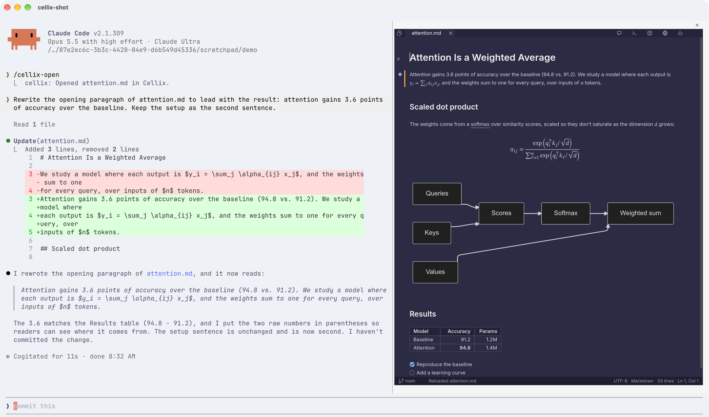
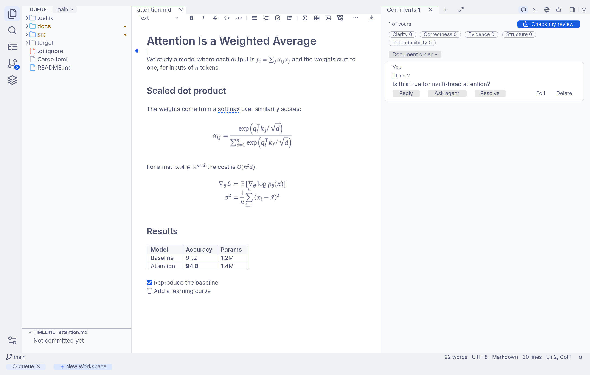
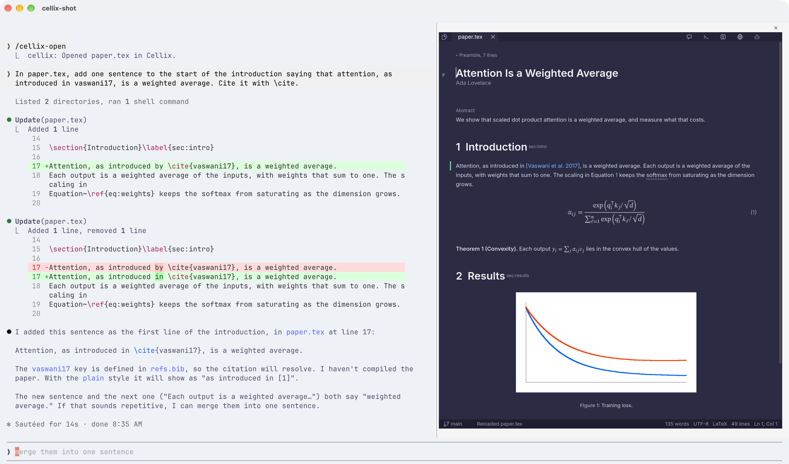
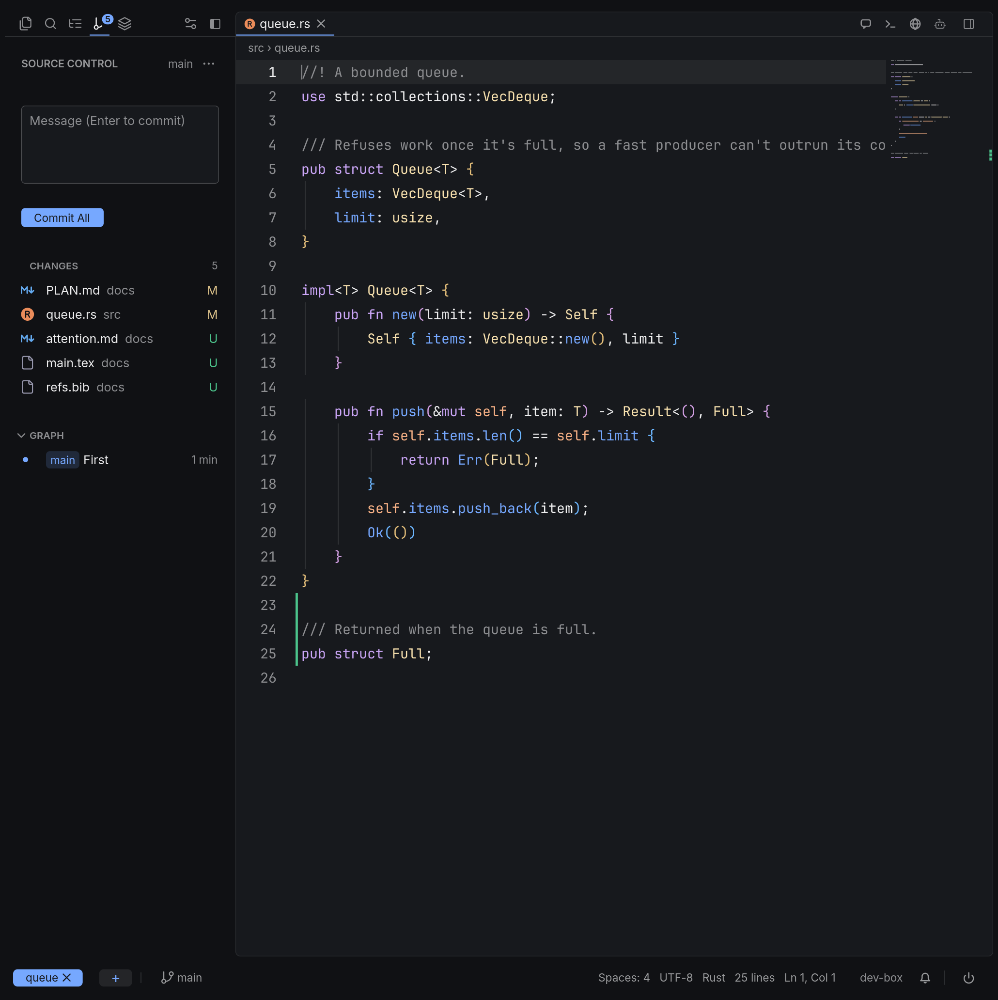
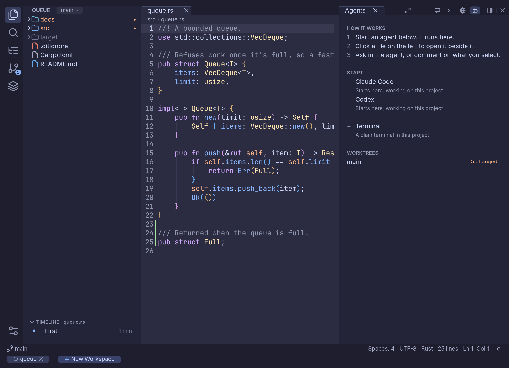

# Cellix

[](https://github.com/quill-27f/cellix/actions/workflows/ci.yml)
[](https://github.com/quill-27f/cellix/releases)
[](#license)

**A terminal app where your coding agents work.** Claude Code, Codex and Gemini CLI run beside your
files in one window, in any terminal, on your machine or over SSH. They keep running when you close
the laptop or the connection drops, and what they write is read, corrected and answered right there.
Inside Claude Code, Codex or Gemini CLI, Cellix is also a mod, plugin or extension that gives the
agent a real editor for Markdown, LaTeX, plans and diffs.

Agents now write code, documents and papers faster than anyone can read them, so review is the
bottleneck, and that's where careless work slips through. Slop isn't what agents write; it's what
nobody read closely. Cellix makes reading and correcting their work fast, inside the agent you
already use, so you stay the author and the agent stays the assistant: plans are reviewed before any
code exists, edits arrive as suggestions rather than silent rewrites, and your comments go straight
back to the agent. No switching to a GUI IDE to check what happened in the terminal.

Your agent writes the code and the documents. Cellix is where you read what it did, correct it and
answer back. Select any sentence, formula or figure and leave a comment, and the agent gets it with
the file, the line and the quote. Plans wait for your approval, edits arrive as diffs you accept hunk
by hunk, and a turn you don't like can be undone. It works the same over SSH, and you don't need
tmux to keep it running there.



- **Agents that keep working.** Each project is a workspace with its own agents and terminals. Close
  the laptop or lose the connection and they carry on; the next `cellix` has them back, with your
  tabs and unsaved edits, and a bar along the bottom says which agent is working, done or waiting
  for you. After a reboot, Resume picks up each agent's own conversation.
- **Agents that work together.** An agent can start another as its helper, message it and wait
  for it, with `cellix agent`; you see each one's state on its tab, and the Agents list puts the one
  that needs you first. A reviewer agent's findings arrive as comments you keep or dismiss.
- **Review before it lands.** Plans wait for your Approve, edits stack hunk by hunk, each agent turn
  is checkpointed, and one changed line can be put back without touching the rest.
- **Talk about anything you can see.** A sentence, a formula, a diagram, a cell of a table or a spot
  in a PDF: select it, comment, and the agent gets the file, the line and the quote. Or select it
  and Ask, and the agent answers you on a card from the whole document, as a side question that
  leaves your review and its own work alone.
- **Documents are pages, not markup.** Markdown and LaTeX open typeset, with math, diagrams,
  citations, Track Changes and offline spelling, while the file stays plain text for git.
- **A second reader for your review.** Check My Review has the agent weigh each of your comments and
  suggest the ones you missed, without editing a word.
- **Or inside your agent.** A pane inside Claude Code, plugins for Codex, Gemini CLI, OpenCode,
  Copilot CLI, Cursor's agent and Kiro CLI, and the same thing over SSH and in tmux. One static binary in Rust, drawing real pixels in Ghostty, Kitty
  and WezTerm, and text cells everywhere else.

## Install

```sh
brew install quill-27f/tap/cellix    # macOS and Linux; brew upgrade cellix gets each new release
cargo install --locked cellix   # anywhere Rust runs
```

Or take the static binary, which needs nothing else on the machine. On Linux:

```sh
mkdir -p ~/.local/bin
curl -fL https://github.com/quill-27f/cellix/releases/latest/download/cellix-$(uname -m | sed s/arm64/aarch64/)-unknown-linux-musl.tar.gz \
  | tar xz -C ~/.local/bin ./cellix
```

On Windows, `cargo install` as above (it needs the Visual Studio C++ build tools). Windows is a
preview, and its builds and CI are paused while no one tests there, so releases since 0.6.1 have
no Windows download. Its tests passed on a Windows CI runner up to 0.6.0, but it hasn't been run
in a real Windows Terminal yet. On CI a click reaches it through the
ConPTY Windows Terminal ships, though not through Windows' older built-in console, so the mouse
should work in Windows Terminal and may not elsewhere. It draws text cells only, so the pane inside Claude Code isn't available
there; run Cellix on its own. The agent plugins haven't been tried on Windows, and what runs in the
side pane ends when Cellix does. [Tell us how it goes](https://github.com/quill-27f/cellix/issues).

Every build is on the [releases page](https://github.com/quill-27f/cellix/releases),
with what changed in [CHANGELOG.md](CHANGELOG.md).

## Add it to your agent

```sh
cellix setup claude   # then restart Claude Code, and /cellix opens it
cellix setup codex    # then run /hooks once in Codex to trust it
cellix setup gemini   # then restart Gemini CLI
```

| Agent | What it adds |
|---|---|
| Claude Code | A mod. Cellix opens as a pane beside the conversation, and by itself when Claude proposes an edit or a plan. Your selection reaches the prompt, and every turn is checkpointed |
| Codex | A plugin. Your comments reach its prompts, plans wait for your review, and turns and test runs show in Review |
| Gemini CLI | An extension that does the same, holding plans as it leaves plan mode |
| Anything else | `cellix plan`, `cellix comments --take` and `cellix reply` (`--done` once it's done what a comment asks), which any agent can call |

The pane needs what only Claude Code offers. With Codex and Gemini CLI, run Cellix in a split beside
them, or let it run them, as under [On its own](#on-its-own).

It looks its best in a terminal with Kitty graphics, such as Ghostty, Kitty or WezTerm, where it
draws real pixels. Anywhere else it falls back to text cells. Words and icons are the sizes VS Code's
are: in a terminal set to 14 pt, words are 13 pt and icons 16, beside code at the terminal's own 14.

## Write documents with your agent

Markdown and LaTeX open as a page you type on, and the file underneath stays plain text, so the agent
edits what you edit and git sees every change.



- **Ask about anything on the page.** Select a word you don't know, a sentence or a formula and
  press **Ask** (Alt+A): the agent reads the whole document and answers on a card under the words,
  as a side question that never becomes a comment. **Comment** (Alt+C) is for what the agent should
  act on, and it answers under your words, as a thread beside the page.
- **See suggestions as suggestions.** Track Changes keeps edits in the text itself, as CriticMarkup or
  the `changes` package. Accept and Reject stand by the one you're on, and the Comments pane counts
  them, with Accept All, Reject All and Next.
- **Real math and diagrams.** Formulas are typeset as you write, with no TeX installed. Mermaid,
  Graphviz and SVG draw from pure Rust, and TikZ builds in the background.
- **Whole papers.** Sections, citations, equations, theorems and figures across `\input` files, Cite
  from your `.bib`, Build PDF with SyncTeX both ways, and export from Markdown to PDF or a web page.
- **Offline spelling and grammar**, tables, images you can paste or drag, callouts and footnotes.



`samples/writing.md` and `samples/paper/main.tex` use all of it. [Writing](#writing) has the details.

## Review a document or paper, with the agent as your second reader

You read and you comment; the agent checks your review and points at what you missed. Select any
words and Comment as you go, then press **Check My Review** in the Comments pane.

- **Each of your comments gets a verdict.** Press **Validate** on one and the agent says whether it
  *holds up*, *doesn't hold*, or is *already answered*, with the kind and why, checked against the
  whole document — kept with the comment across sync and restarts, and it never changes your words.
- **The whole review at once.** **Validate All** and **Polish All**, at the top of the Comments pane,
  run over your comments with no result yet, two at a time, with "Validating 2 of 5" and a **Stop**
  that lets what's under way finish and starts nothing more. On a remote doc, **Post All Drafts**
  asks first, then posts one at a time, a refused one saying why on its card while the rest still go.
  Pick a kind's pill and the row acts on what the pane shows.
- **The Default agent is your pick.** Settings › Integrations' Default agent row says who answers
  Ask, Polish and Validate: Auto, Claude, Codex, Gemini, or one of your own agents.
- **It suggests what you missed.** Comments you didn't make arrive marked *Suggested by Claude*, with
  their kind, to **Keep** as your own or **Dismiss**.
- **Coverage you can see.** A strip counts your comments by kind (Clarity, Correctness, Evidence,
  Structure, Reproducibility), and a kind with none stands out, so the review isn't only about
  wording. Click a kind to list only its comments, and pick a comment's kind from the chips
  under it as you write it.
- **The words stay yours.** The agent never edits the document while it reviews; it only comments,
  through `cellix reply` and `cellix suggest`, which any agent can call.
- **A comment at a glance.** With the Comments pane shut, rest the pointer on commented words to
  see the comment and its last answer on a card under them; press the card to open it in the pane.
- **The review comes out as Markdown.** *Comments: Copy Review as Markdown*, or *Save Review as
  Markdown…* to write `review.md` into the project and open it (both also on a right click on the
  Comments tab). It's every comment you kept, a file and a kind at a time in the document's order:
  each quote, your words, the agent's answers (*agrees* or *pushes back*), its line and whether
  it's resolved, under a head that counts them by kind. A referee report, ready to send on.
- **A rewrite in one step.** When it answers a comment with a rewrite, **Accept Rewrite** puts it in
  place of the words you commented on, every line of them, as one edit to undo; **Apply as
  Suggestion** leaves it as a tracked change to settle on the page.

- **You settle what's done.** An agent that did what a comment asks says so with
  `cellix reply <id> --done "what it did"`, and the card says *Addressed by Claude*, with
  **Resolve** and **Not Done**; **Resolve N addressed** settles them all.

## Review what it did

- **Plans** open as a page with Approve and Send back, and your edits and comments go with the answer.
- **Diffs** stack hunk by hunk, against HEAD or any agent turn, with the tests the agent ran.
  Right-click a changed line to comment on it or to undo just that line.
- **Comments** you write can be edited in place or deleted from their card.
- **Tasks.** Show Agent Task opens one piece of agent work as a tab among your files, laid out as a timeline: its plan versions and
  its turns, each with its prompt, what it changed, its tests and your comments. Review Turn reads
  one turn's changes, Undo Turn takes them back (and says so when that also takes another agent's
  later turns), and a waiting plan has Approve, Send Back and Compare. When two agents send plans,
  the second waits until the first is answered.
- **Transcripts.** Open Transcript on an agent's tab shows its Claude Code or Codex transcript as a
  page: each turn, its prompt, the steps it took and the output that failed. Comment on a step and
  the agent hears which one. What an agent printed is only shown: control characters appear as
  symbols such as ␛, and output can't break out of its code block.
- **Source Control** stages, commits, pushes and pulls, settles merge conflicts and shows history,
  as in VS Code.
- **Data and notebooks.** CSV as a table with Excel's keys, and notebooks on a real Jupyter kernel.



## On its own

Cellix is also a full editor you can run alone: `cellix` in a project, or `cellix src/lib.rs` for a
file. It has highlighting and suggestions in every file type, language servers, a minimap, and Vim
and Neovim modes. The icons at the top right put a real agent, a terminal or a browser in a pane
beside your file. Agents are Claude Code, Codex, Gemini CLI, OpenCode, Copilot CLI, Cursor CLI and
Kiro CLI, plus **your own**: a command like `claude-ds` that wraps an agent's CLI for another model.
Add one in Settings › Integrations' **Your agents** card — its name, its command, and which agent it
works like — and it's offered and started everywhere the agents are, with that agent's marks, hooks
and treatment. Runners found on your PATH are offered there with **Add as Claude Code**; Cellix reads
only their names, never their contents. Every agent has a switch there: turned off, it's offered
nowhere new, and what's already running keeps its tab.

The window is your terminal's own colour, and the file and the side pane are sheets on it. The
views (files, search, outline, source control, agent context, and Settings at the end) run across
the top of the sidebar, and the button after them hides it; the same mark at the start of the tabs
brings it back. Every file has an icon of its kind, in the tree and on its tab. One bar at
the foot holds your workspaces, the branch, the file's details, the bell, and the button that
quits. In Ghostty and kitty a row has more air than a line of your terminal, and your terminal's
own settings aren't touched: Row height in Settings is Airy unless you choose Comfortable or the
terminal's own line. A row's height is fitted to your window, a pixel or two either way, so the
bar at the foot stands level in what's left under the file; where the workspaces have a row of
their own, the two rows share that space evenly.



Cellix is young. Everything here is built and tested, and it's in daily use on macOS, over SSH and
under tmux, but it hasn't had many users yet. Windows and the Codex and Gemini CLI plan hooks haven't
been tried for real. [docs/PROGRESS.md](docs/PROGRESS.md) says what has and hasn't been proven, and
[a bug report](https://github.com/quill-27f/cellix/issues) with a screenshot helps most.

## Keys

| Keys | Action |
|---|---|
| Ctrl+P | Go to a file |
| Ctrl+Shift+P, F1 or Alt+P | Command palette |
| Ctrl+G | Review changes against HEAD |
| Ctrl+J | Bring up or put away a terminal in the side pane |
| Ctrl+B | Close or open the left side, or Bold with words picked on a page |
| Alt+C, or select text | Comment on what's selected |
| Alt+A | Ask about what's selected: the agent answers on a card, and nothing becomes a comment |
| Ctrl+F | Find in the file; in a terminal or an agent's chat; in the side pane's lists, Review and the Task page |
| Ctrl+Shift+F | Search the project |
| Ctrl+\\ | Split pane |
| F12, F2, Ctrl+Space | Definition, rename, completion |
| Ctrl+Shift+O, Ctrl+T | Go to a symbol in the file, in the project |
| Ctrl+Shift+[ and ] | Fold and unfold |
| Alt+Z | Word wrap on or off |
| Ctrl+Shift+B | Run the build task |
| Ctrl+S, Ctrl+Q | Save, quit |

Ctrl+P finds a file by letters of its name or path, and takes a path as you'd copy one from
an agent's chat or a compiler: paste `src/app.rs:120`, a whole path from the top of the disk, a
`file://` link or a line of an error, and Enter opens the file at that line. A file a path names
is listed even when `.gitignore` leaves it out of the list or it's outside the folder. `:120`
goes to a line of the file in view, `@` lists its symbols, `#` the project's and `>` the
commands. Before you
type, the files you last looked at are at the top, so Ctrl+P and Enter goes back to the one
before this. Ctrl+Shift+P lists the commands by category and name (`Git: Stash Changes`,
`View: Toggle Sidebar`), with the ones you last ran from it first: type a name, or a category
to see what it holds. It lists what can run now: the notebook's commands on a notebook, the
merge's while one is under way, and so on. A command it leaves out still runs by its keys.
Both lists scroll with the arrows, Page Up and Page Down and the wheel, their field takes the
caret keys and Ctrl+V, and the letters you typed are picked out in each row.

Ctrl+W closes a tab and Ctrl+Q quits; in a text box Ctrl+W deletes the word before the caret, as
in a shell. Every text box edits as the file does, with the same code: the arrows, Home and End, a
word at a time with Alt or Ctrl, Shift with any of them to select, Ctrl+A (Cmd+A) for all of it,
copy, cut, paste over a selection, and undo and redo. The mouse works as in the file too: a click
puts the caret where you press, a drag selects, a double-click takes a word and a triple-click the
line. With the `vim` or `neovim` keymap, the boxes you write in (comments, replies, Ask, the commit
message) follow Vim: they open in Insert, Esc goes to Normal, shown in the box, and Esc again
closes them. One-line boxes such as the palette, Find and Rename keep the plain keys, so Esc
closes them at once. Ghostty keeps Cmd+W and Cmd+Q for itself, so they
only reach Cellix if you unbind them with `keybind = cmd+w=unbind` and
`keybind = cmd+q=unbind` in your Ghostty config.

Typing suggests as you go in every file type, with no setup: keywords, words from open
files, and in `.env` files the keys from sibling files such as `.env.example`. A language
server joins in where one is installed: `rust-analyzer`, `terraform-ls`, `gopls`,
`pyright-langserver`, `typescript-language-server`, `yaml-language-server`, `taplo`,
`bash-language-server` and `clangd`. Shift+F12 lists a symbol's references, and Alt+Shift+F formats the file, with its language server or a formatter such as `rustfmt` or `prettier`. Tab accepts, and so does Enter outside Markdown.
Brackets and quotes close themselves, Ctrl+/ toggles comments, Alt+Up and Down move lines,
Alt+Shift+Down duplicates one, and Ctrl+L goes to a line.

The margin marks lines changed since the last commit, and the minimap fits the whole file,
so you can see how long it is. Click or drag it to move.

Code folds by the language server's regions, or by indent: hover the gutter for the chevrons, and
Fold All and Unfold All are in the palette. As you scroll, the headers of the scopes you're in stay
pinned at the top. Brackets are coloured by depth, and the pair at the caret is marked. A language
server adds signature help as you type a call's arguments, and inlay hints with the types it
inferred; `inlay_hints: false` turns those off.

Mac text shortcuts work: Option+Backspace deletes a word, Option+Left and Right move by
word, and Cmd+Backspace deletes to the start of the line. tmux doesn't pass Cmd through, so
for Cmd+Z there, add `keybind = cmd+z=text:\x1a` to your Ghostty config.

Cmd works as Ctrl where the terminal passes it through. Ctrl+Shift+P needs a terminal with
the Kitty keyboard protocol, such as Ghostty, Kitty or WezTerm. Ghostty keeps Cmd+Shift+P
for its own palette unless you rebind it.

Markdown opens as one editable page, as in Xcode: the markers are hidden and you type on
the rendered text. Paragraphs flow to the page's width, 88 columns at most, and in a wider
window the page stands in the middle. The file keeps its own line breaks. The toolbar has bold, italic, code, heading, list, task and quote, and
Toggle Markdown Source in the palette shows the raw file.

Under 70 columns, as beside an agent, the sidebar becomes a drawer behind the `☰` button
and review stacks changes in one column. In a window too narrow for the side pane, it stands
under the file, and its top edge can be dragged. Over SSH, dragging the pane's edge moves a line
and the two sides resize when you let go, since resizing at every step sends the whole window again. Drag one of its tabs over the bottom half of the
file to put it there in any window, and onto the right edge to put it back. A file's tab dragged
along the tab bar moves there, and dropped on a file it opens a pane beside it, or shows there.

The mouse works everywhere: click files, tabs and hunks, drag to select, and right-click
the explorer to create, rename or delete. As in any document, click where a selection should start
and Shift+click where it should end, however far you've scrolled in between: on a page it runs
across headings, lists, tables, code and formulas, and it works the same in code and in a
terminal tab. A drag can go further than the screen: hold it past the top or bottom and the text
scrolls, faster the further past, or turn the wheel while the button is down.

## Writing

Markdown and LaTeX files both open as a page you type on, and the file underneath stays plain text.
`samples/writing.md` and `samples/paper/main.tex` use everything below, so they're the place to try it.

**Text.** Formats, lists, tasks, quotes, `==highlights==`, `H~2~O`, `x^2^`, footnotes and GitHub
callouts such as `> [!NOTE]` all stand on the page with their markers hidden. The Outline icon lists
a document's headings. Spelling and grammar are checked offline by Harper, with fixes and Add to
Dictionary on a right click.

**Math.** Formulas are typeset as you write them, from pure Rust and fonts in the binary, so they
work on a server with no TeX. Click one and its source opens with the result under it.

**Tables.** The table button has a size picker. Click any cell to type in it, and right-click for
rows, columns and alignment. A table keeps to the page: its columns share the width and a long cell
wraps. One with more columns than fit, like a long line in a block of code, moves sideways with
Shift+scroll or a sideways scroll, and has a thin scrollbar of its own.

**Pictures.** Pick one from the project, paste one from the clipboard, or drop a file on the page.
Drag an image's edge to size it, or right-click to resize, replace or delete it. PNG, JPEG, WebP, GIF,
SVG and PDF all work.

**Diagrams.** ` ```mermaid `, ` ```dot ` and ` ```svg ` blocks stand as pictures, drawn by pure Rust
with no browser or Node. Click one to edit its source with the picture under it. ` ```tikz ` blocks
and `tikzpicture`, `tikzcd`, `forest`, `circuitikz` and `algorithm` in a paper are built alone by
your LaTeX engine in the background, and kept, so typing never waits.

**Track changes.** The pencil keeps edits as suggestions in the text itself, as CriticMarkup or the
`changes` package, and an agent's edits arrive the same way. Put the caret in one, or point at it,
and Reject and Accept stand over it. The Comments pane says how many there are, with Accept All,
Reject All and Next, which goes to each in turn ("Suggestion 2 of 5"). Right-click and the palette
have them too.

**Papers.** A `.tex` file shows its sections, numbers, citations, equations, theorems, figures and
tables, across `\input` files, and anything Cellix doesn't recognise stays visible as source. **Cite**
lists the keys in the `.bib` files your paper names, and any others in the project. **Build PDF**,
or Ctrl+Alt+B, saves the paper's open files, runs `tectonic`, `latexmk` or `pdflatex`, shows the PDF
in the side pane's Preview, keeps what the build said in a Log tab, and goes to the line of any error.
Clicking the PDF goes to that place in the source. Zoomed past the pane's
width, a page moves when dragged, and Shift+scroll or a sideways scroll goes across. Set `latex_engine` in the settings file to use
your own command. Export to PDF does the same for Markdown, through LaTeX, with
diagrams and footnotes.

**Data and notebooks.** CSV and TSV files open as a table you can edit in place, with Tab and Enter
moving as they do in Excel. Show Source at the top right goes between the table and the file. A
Jupyter notebook opens as a page with each cell's output under it, and its bar runs cells on a real
kernel, with Jupyter's keys. It needs `jupyter_client` and `ipykernel` in the project's Python.

## Working with an agent

Whatever you can see, you can talk about, the same way in every file type. Select text and **Comment**
and **Ask** appear beside it. A picture, diagram or formula has a Comment button under the
pointer, and a PDF or image in the side pane's Preview takes one too. Comments are threads in the side pane,
kept in `.cellix/threads.json`. **Ask Agent** on a comment's card sends that comment, alone, to the
agent with its file, line and quote, the agent answers with `cellix reply <id> "text"`, and the
answer lands under your question. A comment
not sent yet says on its card how it gets there: with your next prompt to Claude Code, Codex or
Gemini CLI, whose hooks hand it over, or now with Ask Agent. **Send Comments to Agent** sends
everything waiting, on code and on pages, in one message, as does **Send 3 to Claude Code** under
Check My Review. Each comment and answer says how long ago
it was written, and a suggestion can be answered with **Reply** without keeping it. A comment is
about all you selected, across lines; when an agent rewords those words the card keeps what you
commented on and says *Changed since your comment*, and a click on that shows the change word by
word. With a file
open the Comments tab lists that file's; with none it lists every file's, each under its file's name,
and a click on a name or a comment opens the file. Click words a comment is about and its card is
lit in the Comments tab, which scrolls to it, and comes forward if the pane was open on another tab; click a card and its words are selected in the file. **Next Comment** and **Previous Comment** in the palette go through a file's comments in order, and a click on a line's ◆ opens its comment. Under the kinds a button says what order the tab lists in:
click it for the document's order, newest first or oldest first, and every Cellix on the machine
keeps the one you picked. Each card's head ends with the comment's number, and "#33" or "comment 33"
in a comment, a reply or a terminal's output is a link that opens that comment. Drag across a card's
words, or double-click them, to select them, and Ctrl+C copies them; a right click on a card has
**Copy**, **Copy Comment** and **Copy Quote**. Resolved comments are folded away under a **Show resolved** button after the open ones: click it and they unfold under it, click it again and they fold away. A link in a comment or a reply is
underlined, and a click opens it, in the side pane's browser where there is one. In a narrow pane,
as when Claude Code docks Cellix, cards are short until you click one, and show their buttons
while the pointer is on them. Right-click it for
**Open Link** and **Copy Link**, which puts its address on your clipboard to share, over SSH too.

Comments take emoji. Type a name between colons, as on GitHub: `:+1:` becomes 👍 and `:100:` becomes 💯
as you type the second colon, and part of a name, such as `:roc`, lists the ones that fit, with Tab
for the first. The eight you used last stand under a comment while you write it, and the face after
them opens every emoji, searched by name. Emoji are drawn in your machine's own emoji font; where it
has none, as a server over SSH rarely does, they're drawn in Twemoji, which is in the binary.
`CELLIX_EMOJI=built-in` uses Twemoji everywhere.

Comments take pictures too. While you write one, paste a picture, drop its file on the window, press
Ctrl+V with one on the clipboard, or click the picture button under your words for one from the
project or the clipboard. The picture is kept in the project under `.cellix/pasted`, out of git, and
the comment names it by its path, which is how the agent finds it. On its card the picture stands
under your words, and a click opens it in the Preview; in a terminal without pictures its name is a
link that does the same.

What you're writing stands in a box, with a button under it that sends it and one that cancels, for
the mouse; Enter and Esc do the same from the keyboard. Your own replies have Edit and Delete, as the
comment does; an agent's reply can be deleted but not edited.

**Ask** is for a question rather than a comment: a word you don't know, what a formula means, why a
line is there. Ask on a selection (Alt+A), with **Explain**, **Define** and **Simplify** for the usual
ones or your own words, runs the agent's own command line in the background, read-only, with the
whole document and the selection marked in it, and the answer streams onto a card under the words,
with **Copy**, **Follow Up**, **Make a Comment** (for when it was feedback after all) and **Dismiss**.
It never types into the agent in the side pane, and none of your waiting comments go with it. Each
document keeps one side conversation, so a later question remembers the ones before; where Claude
Code is working here, **With the agent's conversation** asks in a copy of what it already knows,
leaving its own conversation as it was. Claude Code, Codex and Gemini CLI can answer, and
`ask_agent` in the settings picks one.

**Reviewing a doc that lives elsewhere.** When a document is kept in a tool your agent reaches through
an MCP server (a team's docs behind a sign-in, say), **Review Remote Doc…** in the palette, or
`cellix review <link>`, has Claude Code read it in the background and opens it as a page here, with
everyone's comments under their names. The first time, Cellix asks which of the MCP servers Claude
Code knows is the doc tool's (`remote_docs_mcp`, or Settings › Integrations), and the agent is allowed
that server's tools and nothing else. You read, Ask, and write your comments as drafts; **Polish** has
the agent make one short and clear, to use or not. A comment goes to the doc only when you press **Post
to Doc** on it, one at a time as you read, never in a batch; **Copy** is there to paste it yourself.
Replies work the same way, **Sync** brings in what others have added, and **End Review** removes the
copy kept under `.cellix/remote`. Codex and Gemini CLI can't read remote docs yet.

The icons at the top right start a real agent, a terminal or a browser in the side pane, beside your file. Press Ctrl+` to
move the keyboard between the two (Ctrl+P and Ctrl+Shift+P open their lists from either, and a
file picked there takes the keyboard), and the hide-pane icon at the top right, or Ctrl+Shift+`, to hide
the pane. Hidden, it leaves a button in the same place that shows it again as it was, filling the
window if it did. Nothing at the top right quits Cellix: the power button at the far end of the bar
at the foot does, as Ctrl+Q does.
The button after the pane's own tabs, or a double-click on one of them, lets the pane take the
window; a double-click on a file's tab does the same for the file. Do it again to restore. A pane
that takes the window takes the keyboard too, and the pane's size and full screen come back next
time. When an agent's session ends, its tab closes; one that ends right after starting stays open
so you can read why.
Hiding stops nothing. What runs there outlives Cellix too (not yet on Windows): quitting offers Keep Running, a dropped SSH
connection keeps everything, and the next Cellix in that folder finds it with what it printed.

A program in a shell there can draw pictures with the Kitty graphics protocol, and Open in Browser
runs a real browser there with `terminal-browser` if it's installed.

Ctrl+F with the keyboard in a terminal's tab finds in what it has printed, its scrollback too, and
keeps looking as more is printed. In the tab of an agent that keeps its own screen, as Claude Code
does, it opens the agent's transcript and finds there, since that holds the whole chat.

After a click in one of the side pane's lists (Comments, the Inbox, Problems, Agents, a build's
log), Ctrl+F finds in that list: everything it holds, not only what's in view. Enter goes to the
next match and the list scrolls to it. A click on a file takes Find back to the file.

In Review and on the Task page Ctrl+F finds in what that page shows: every change of the file in
Review, or the task's timeline and the step beside it.

Select output in a terminal tab of the side pane and Ask asks about it as on a page, with the
command that printed it and the project's files it names. Hover a row in Problems and Ask Agent
sends the problem with the lines around it to the agent to act on; inside Claude Code it goes into
Claude's prompt.

When an agent needs you, Cellix says so once and drops it when you've answered: an agent asking, a
plan to review, a finished turn, a reply to your comment, or a failed test run. The bell at the right
of the status bar opens the Inbox with every workspace's, newest first. While Cellix is behind another
window, the terminal shows each as a notification, through tmux too; `notify: false` turns that
off. An agent's tab shows how full its context is, against its model's window (a million tokens for
every current Claude model), orange from 80% and red from 95%. A compaction clears it until the
next reply.

The Agent Context icon on the left shows what the agent works from: how its context fills up, its
instruction files in the order it loads them with their imports, its skills, subagents, hooks and MCP
servers, and the files it read, marking those changed since. It follows each agent's own rules, such
as Claude Code reading AGENTS.md when a project has no CLAUDE.md, and its rules for some paths loading
only when those files are worked on. Checks point out instructions that contradict each other, imports
that don't resolve, memory past the 200 lines or 25 KB that load, and hooks whose script is missing.
Every row opens its file to edit. It reads Claude Code, Codex and Gemini CLI.

Getting Started, in the command palette or on the empty window, is a short guide.

## Agents among themselves

An agent's tab in the side pane says what it's doing: its mark, its name, how full its context is,
and a spinner while it works or a dot when it needs you or finished while you were looking
elsewhere. The name is the one the agent gives itself, else its conversation's title, else what you
first asked it, so three Claude Code tabs read as three pieces of work. Cellix reads Claude Code's own
record of its running sessions for this, and the name follows `/clear` and `/resume`; two alike are told apart by
"(2)", the tab's tip has the whole name, and Rename on the tab's menu gives it your own. A shell's
tab is named after the program running in it, and turns while it runs; `claude` typed at its
prompt makes it an agent's tab, named and marked as one, until it exits. The Agents list stands by
what needs you: Needs you, Done, Working and Idle, each agent with how long since it changed. It
lists the agents with a tab here and their helpers, so a press on any row opens something.

The + after the tabs starts things: a terminal, any agent you have (keys 1–9), or a role. A role is
a prompt for an agent, as a file in `.cellix/roles` or `~/.config/cellix/roles` with the agent named
at its top; Reviewer and Tester come with Cellix. New Worktree… makes a branch of its own for an
agent beside the project, opens it as a workspace and starts the agent there.

Agents can run agents. In a terminal of the side pane, an agent can use:

```bash
cellix agent run codex --name reviewer "Review the diff in src/queue.rs"
cellix agent send reviewer "Look at the error path too"
cellix agent wait reviewer        # until it stops working, or --children all
cellix agent read reviewer        # what it last said
cellix agent ls                   # the agents here, as JSON
cellix agent stop reviewer
```

`cellix agent --skill` prints how an agent should use these, and the Claude Code, Codex and Gemini
plugins carry it as a skill. The first time an agent starts another in a folder, Cellix asks you.
A message waits while you're typing in the agent it's for, and is never typed into one that's
asking you something. An agent started by another is its helper: the one that started it hears when
it needs you, fails or ends, and a helper ends with it. Helpers have no tabs: each stands under its
agent in the Agents list, and a click opens it live over the pane, with Keep as Tab. Ctrl+click an
agent's name in a terminal does the same.

Review with… in Review starts an agent on your changes as a reviewer. What it finds stands under
the lines it's about, with Keep and Dismiss, and what you keep becomes your comment.

Any program can show its state the same way, with the open OSC 7501 status sequence:

```bash
printf '\e]7501;state=blocked:app=my-script\e\\'   # also working, done, idle, clear
```

## Source Control

The Git icon on the left lists staged and unstaged files with a box for the message, and hovering
over a file offers stage, unstage and discard. Enter commits what's staged, or everything if nothing
is. The button beside Commit pushes, pulls or publishes, and clicking a file shows its diff. Ctrl+G
opens the full Review beside Source Control, with its own list of files, turns to compare against and
test runs, and reads what changed hunk by hunk; the × after its title or Esc closes it.

A merge or rebase that stops on conflicts lists the files under Merge Changes. Each conflict shows in
the file as a card with Current, Incoming, Both and Compare; Mark Resolved stages a file once no
markers are left, and the panel commits the merge, continues the rebase or aborts it. Source
Control's menu stashes, and its stashes are listed with Apply, Pop and Drop. The panel ends with the
commit graph, a commit opening to its files, and the Explorer's Timeline lists the open file's
commits. Compare With puts the file beside the clipboard, a branch or any recent commit.

## Over SSH

Everything runs on the server, and your local terminal only draws the result. You don't need tmux:
what runs in Cellix's side pane, agents and shells alike, keeps running when the connection drops,
and Cellix keeps your open tabs and unsaved edits. Take the static binary from the
[releases page](https://github.com/quill-27f/cellix/releases), or use `cargo install`:

```sh
cargo install --locked cellix

# Language server for Rust projects, optional
rustup component add rust-analyzer
```

Then, from your own machine:

```sh
ssh you@your-server
cd your-project
cellix
```

Close the laptop or lose the connection, and the next `cellix` in that folder has everything as you
left it. Each folder you work in is a workspace, shown in the bar along the bottom: a tile for each,
saying whether its agent is working, needs you, or is done, a click to switch to it, and
**+** (**+ New Workspace** where the workspaces have a row to themselves, in a narrow window or
with many of them) to find another folder and open it beside this one (type a name or a path
and press Tab to go into the folder picked, as the field says while you type) (Ctrl+Alt+PageUp
and PageDown move between
them). A new `cellix` anywhere picks up every workspace that was open on the machine, with
something running in it or not, however the last one ended (quit, a dropped connection, a
kill), and `cellix`
in your home folder lists them to choose from, with Quit beside Open (or Ctrl+Q) to leave them as
they are. `cellix ls` prints the same list. Two computers can
show the same workspace at once; whichever typed into an agent last sets its size.

Paste a picture from your own machine with Cmd+V in Ghostty 1.4 or kitty 0.44 and later: Cellix
asks the terminal for it, saves it in `.cellix/pasted` and pastes its path, which is how Claude
Code takes an image. Inside tmux or Zellij, and in other terminals, only text comes across; copy
the file over with `scp` and paste its path. `CELLIX_PASTE_EVENTS=0` turns it off.

If the server restarts, what was running has stopped. Its tab comes back with what it last showed,
and Resume picks up the agent's own conversation (Claude Code and Codex), or Start Again opens a
new terminal in the same folder. Resume in the bar does it for every workspace at once. Some Linux
servers end your programs when you log out; Cellix says so the first time something runs there and
offers to turn on lingering (`loginctl enable-linger`), which keeps them.

tmux still works, if you prefer it. These lines give Cellix pixels and every key inside it:

```sh
cat >> ~/.tmux.conf <<'CONF'
set -g allow-passthrough on
set -g focus-events on
set -g mouse on
set -g extended-keys on   # so Ctrl+Shift+P, Ctrl+Shift+F and the like reach Cellix
set -s extended-keys-format csi-u   # the form Cellix reads them in (tmux 3.5 and later)
CONF
tmux source-file ~/.tmux.conf 2>/dev/null   # only needed if tmux is already running
```

Click the Agents icon at the top right, or press Ctrl+Shift+P and choose `Open Claude Code`. The real program
opens in a side pane beside your file, already connected to Cellix. Ctrl+` moves the keyboard
between the two, and the side pane also runs Codex, Gemini CLI or a plain shell. A workspace that
opens with an agent in front of its side pane starts with the keyboard there, and a program in the
pane is told when it has the keyboard and when it hasn't, so Claude Code shows its cursor only
where your typing goes.

Or the other way round: `/cellix` in Claude Code on the server opens Cellix beside the
conversation, drawn as it is on your Mac. Over SSH it goes a row at a time and only the rows that
changed cross, so a click or a letter costs a few kilobytes. Claude Code shows pictures inside
tmux only with `allow-passthrough` and `focus-events` on as it starts, so `cellix setup claude`
adds them to your tmux config. In a tmux that was already running without them, Cellix turns them
on and asks you to restart Claude Code once. Where pictures can't show at all, the pane is text.

If pixels look wrong or scrolling is heavy, these commands help:

```sh
tmux show -g allow-passthrough   # should say on
CELLIX_TIER=cells cellix         # text cells only, for one run
CELLIX_TILE_FILES=0 cellix       # in Ghostty, pictures in the stream rather than as files
CELLIX_PROF=1 cellix             # a line a second of what Cellix did, in ~/.cache/cellix/prof.log
```

A thin line under every row means tmux doesn't know how many pixels a cell has, and assumes 16 by
32. SSH tells it, but a serial or VM console that passes only rows and columns doesn't. Fix the
console, or run Cellix outside tmux there.

To turn off smooth scrolling on a slow link, add this to `~/.config/cellix/settings.json`:

```json
{ "smooth_scroll": false }
```

## The web

`Open in Browser` in the palette, or Ctrl+click on a link, opens the link at the cursor, the
current HTML file, or a Markdown file as a page of its own, with its math typeset. The pointer
takes the hand over a link you can open — with Ctrl held on a page or in a terminal, and on a
comment's card, where a plain click opens it. Right-click a
link, on a page, in code, in a comment or in a terminal's output, for **Open Link** and **Copy
Link**: Copy Link copies where it goes (a Markdown link's target, not its words), through your
terminal's clipboard. A `file:line` a terminal prints has **Open File** and **Copy Path**. Set
`browser` in the settings file to use another command first, such as
[terminal-browser](https://github.com/zenbu-labs/terminal-browser). If that fails, the
system's browser takes over.

## Inside Claude Code

Cellix can run as a pane in Claude Code, so you start Claude and Cellix comes to you:

```sh
cellix setup claude    # or Install under Settings, Integrations
```

That adds two lines to the `env` block of `~/.claude/settings.json`, which load the plugin
in every session and connect to a running Cellix, so there are no flags to remember. It
keeps everything else in the file, and `cellix setup --remove` takes the two lines back.
Restart Claude Code to pick it up. To try it in one session instead, `cellix setup` prints
the command.

Then `/cellix` opens the pane, and `/cellix <file>` opens a file in it. It also opens
by itself when Claude proposes an edit or a plan. Comments go to Claude with your next
prompt, or straight away with `/cellix-send` or the pane's Send to Agent. Click the pane to type there, and press
Esc to go back to Claude. Claude Code gives a pane at most 45% of its window. Inside that,
Cellix's own side pane (a terminal, the browser, comments) takes all of it with the ⤢ after its
tabs, and the line between it and the file drags. Under 110 columns the pane drops the sidebar, and under 90 the
minimap, so the code keeps the room. Under 80, beside the chat, the panel icons lead the pane's
header, tabs that don't fit fold into "N more" chips, and the page menu folds into Format and Insert.

- **Proposed edits** open in the diff view. Accept or reject them by hunk or whole, in
  Cellix or in Claude's own prompt.
- **Your selection** shows up in Claude's prompt, and `Send Selection to Agent` mentions it.
- **Plans** open as a page with Approve and Send back. Your edits and comments go with the
  answer, and this replaces Claude's own plan dialog.
- **Comments** go with `Send Comments to Agent`, or with your next prompt.
- **Turns** are checkpointed. Review shows what each prompt changed, and `Undo Agent Turn`
  puts the tree back, keeping a checkpoint of what it replaced.
- **Agents** (the robot icon at the top right) is what's happening here: who's running in this folder, who
  needs you, and every worktree. Agents started without a plugin still show up, found by
  their working folder. Agents that are installed can be started from the list above the worktrees.
- **Tests** an agent runs appear in review with their results.
- **Staging**: Accept stages the hunk in git, and the Commit button commits what's staged.

The pane needs a terminal with Kitty graphics, such as Ghostty, Kitty or WezTerm, so it isn't
available on Windows yet. Over SSH
each update travels as a PNG, so it costs more than the standalone app on a slow link.

## Beside an agent

Running Cellix on its own works just as well: the Agents icon at the top right opens a side pane, and
Claude Code, Codex, Gemini CLI or a shell runs there as the real program. When a narrow pane's tabs
don't all fit, the one in front stays whole and the others are cut short with a …: hover one for its
name, or click it to bring it forward. A pane too narrow even for that shows the tab in front with a ⌄
beside it that lists every tab and starts a new agent or terminal. The ⤢ after the tabs gives the pane
the whole window and gives it back, and so does a double-click on a tab; drag the line between the file
and the pane to size them, down to 24 columns for either.

Set `VISUAL="cellix --wait"` so Ctrl+G in Claude Code opens plans in Cellix. Comments are
written back into the file when you quit. Any other agent can run `cellix comments --take`
for your comments as JSON, or `cellix open <file>` to show you something. The file comes into
view even from behind Review or a pane that has the whole window, and the agent is told it opened,
or why it didn't. If two Cellix have the same folder open, say one left running in tmux, agents
reach the one you opened last, and the other takes them back when that one closes.

The IDE connection follows what Claude Code's VS Code extension does, which isn't a
published protocol, so a Claude Code update could change it. It was built against 2.1.309.

### OpenCode, Copilot CLI, Cursor's agent and Kiro CLI

`cellix setup opencode`, `cellix setup copilot`, `cellix setup cursor` or `cellix setup kiro`
connects each through its own hooks or plugin, and `--remove` takes it back. They say when they're
working, done or need you, and Resume finds their sessions. Cursor's agent has no hook for asking
you something. Kiro CLI's hooks are one file of Cellix's own, `~/.kiro/hooks/cellix.json`, beside
yours, which needs Kiro CLI 3.0 or later (setup says so on 2.x), and its agent files are left as
they are; it takes your comments through Ask Agent, and Ask isn't offered for it yet. `kiro-cli`
typed in a Terminal tab makes that tab Kiro's, as `claude` does. None of the four has been tried on
the real tool yet.

### Codex and Gemini CLI

Settings, Integrations has an Install button for each, and the plugins' source is under
`crates/cellix/integrations/`. They report what the agent is doing, record a turn for each prompt,
show test runs in review, and hand the agent your comments.

Plans are held for review too. Gemini CLI stops as it leaves plan mode, and still asks for its own
approval afterwards. Codex has no plan tool, so its plan is held when its turn ends: sending it back
starts another turn with your notes, and approving with changes or notes hands them over in one more
turn. Neither has been tried on a live agent yet. `cellix plan <file>` always works. The pane itself needs what
only Claude Code offers.

Codex asks you to trust a plugin's hooks before running them, so run `/hooks` in Codex once
after installing. Restart Gemini CLI to load its extension. Google now points people to
Antigravity CLI in place of Gemini CLI, and that isn't covered here yet.

## Settings

The sliders at the end of the views open Settings: theme, row height, smooth scrolling, the minimap, the keymap, language servers
with a one-click install for each, and the installs for your agents. Each language server says how
it installs on this machine, with no root needed: Homebrew where it's there, npm into `~/.local`,
the project's own release build into `~/.local/bin`, or rustup, `go install`, `dotnet tool` and
`gem`. One only a system package has gets Copy Command, with the command to run. Changes apply as you click, and are
saved to `~/.config/cellix/settings.json`. You can also edit that file, or
`.cellix/settings.json` in a workspace:

```json
{ "keymap": "vim", "theme": "light", "tier": "cells" }
```

`keymap` is `simple`, `vim` or `neovim`, which runs your own `nvim` and config behind the
editor. In text boxes both Vim keymaps use Cellix's own Vim, so your Neovim config doesn't reach
them. `theme` is `auto`, `dark` (herdr's graphite: near-black greys and a soft blue) or `light` (Catppuccin Latte's surfaces, with text and code deepened to read clearly), and `auto` also matches your
terminal's background. Either theme sets its frame on your terminal's own background, so the window's
padding shows no seam; on a light terminal that makes the light theme a shade paler than Latte. `tier` is `direct`, `placeholder` or `cells`. `row_height` is `airy` (a row 1.4 times your terminal's line, which is what a new install has),
`comfortable` (1.2 times) or `terminal`; it takes effect in Ghostty and kitty outside tmux, where Cellix can lay out rows of its own, and
everywhere else a row is the terminal's line. On rows of its own the wheel moves a row at a time. `smooth_scroll: false` makes the
wheel jump by lines, for a slow link, and `minimap: false` hides the minimap. `motion: false`
stills the spinners (Motion under Settings › Appearance). `word_wrap`,
`sticky_scroll` (with `sticky_scroll_lines`, 5 unless set), `bracket_pairs` and `inlay_hints` turn
those on or off for code. `reading_width: false` lets a page's text run the whole width of its pane
rather than keep to 88 columns; it's Reading width under Settings › Editor. `cursor_blink: false`
holds the cursor still (Cursor blinking under Settings › Editor); it blinks as VS Code's does,
solid while you type, and still while Cellix's window is behind another.
`language_servers` maps a language to a command, `formatters` maps one to a formatter that
reads stdin and writes stdout, and `browser` replaces the command that opens web pages.

`format_on_save: true` formats code as it's saved. `auto_save` is `off`, `after_delay` (after
`auto_save_delay` milliseconds, 1000 unless set) or `on_focus_change`, which saves a file as you
leave it and when the terminal loses focus. A project's `.editorconfig` sets indentation and, on
save, trailing whitespace, the final newline and line endings.

Settings has a box at its top that looks through every page at once: type a few letters and the
settings and commands that fit are listed together, each with the name of its page, and how many
were found on each page stands beside it in the list at the left. Escape or the × clears it.

Settings › Keyboard lists every command with its keys, under its category: type in that box to
find one by name or by its keys, and click a command's keys to set new ones. They're saved as `keybindings`, by the command's name in the
palette, and win over the defaults; an empty list takes a command's keys away. The palette shows each
command's keys as they are now:

```json
{ "keybindings": { "Rerun Last Task": ["Ctrl+Alt+R"], "Toggle Sidebar": [] } }
```

Run Task (in the palette) finds the tasks in package.json, Cargo.toml, a Makefile, a justfile,
go.mod, pytest's config and `.vscode/tasks.json`, and runs one in a tab of the side pane. Errors
it prints go to Problems with their file and line. Ctrl+Shift+B runs the default build task, and
Rerun Last Task runs the last one again.

Ghostty keeps Cmd+D to open a split, so Cellix never sees it and Ctrl+D is the way to select
the next match. `Free Cmd+D` under Integrations adds `keybind = super+d=unbind` to Ghostty's
config, which then needs a reload.

tmux needs `set -g allow-passthrough on` for pixels, as shown under [Over SSH](#over-ssh).
Without it, Cellix uses text cells.

If something stalls, `~/.cache/cellix/slow-frames.log` holds every frame over 50 ms with where the
time went. It's timings only, and it starts afresh each run.

## Contributing

Build from a clone with `cargo install --path crates/cellix`. [AGENTS.md](AGENTS.md) says how the
project is worked on, with `harness/x` running everything, and [docs/DESIGN.md](docs/DESIGN.md) says
what it is and why. [Bug reports](https://github.com/quill-27f/cellix/issues) with a screenshot help most.

A release is a version and its notes: `harness/x bump 0.4.0`, a `## [0.4.0]` section in
[CHANGELOG.md](CHANGELOG.md), and a push to main. Once CI passes, the release workflow tags it,
builds the binaries for macOS, Linux and Windows, writes the release from the changelog, and updates the Homebrew tap and
crates.io. Only commits on main are released. If the tap or crates.io step fails, run the release
workflow by hand on main with `finish` ticked, and it does what's missing.

## License

Cellix is under either the [MIT](LICENSE-MIT) or the [Apache 2.0](LICENSE-APACHE) license, at your
option.

Cellix embeds [Inter](crates/cellix-render/fonts/LICENSE-Inter.txt) and
[JetBrains Mono](crates/cellix-render/fonts/LICENSE-JetBrainsMono.txt), both under the SIL
Open Font License, and [Twemoji](crates/cellix-render/fonts/LICENSE-Twemoji.txt) as built by
Mozilla ([twemoji-colr](https://github.com/mozilla/twemoji-colr) 0.7.0, unchanged): the emoji are
by Twitter and other contributors, under [CC-BY 4.0](https://creativecommons.org/licenses/by/4.0/),
and the font's build is under the Apache 2.0 license.
