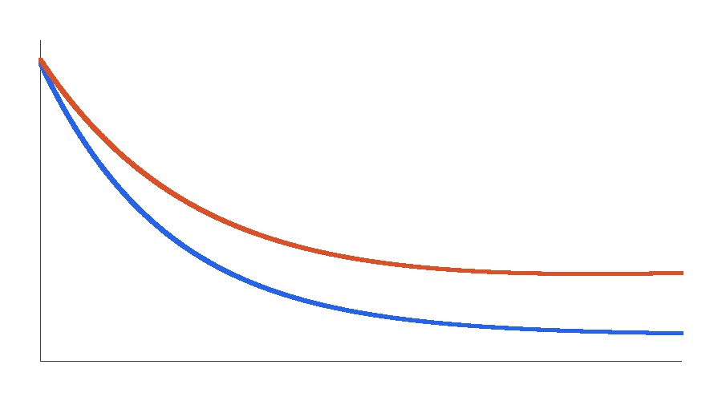
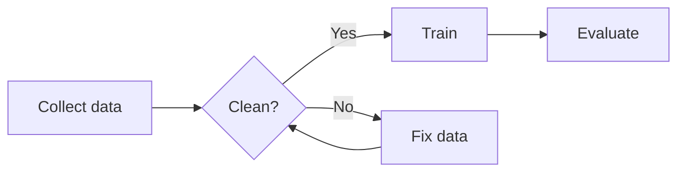
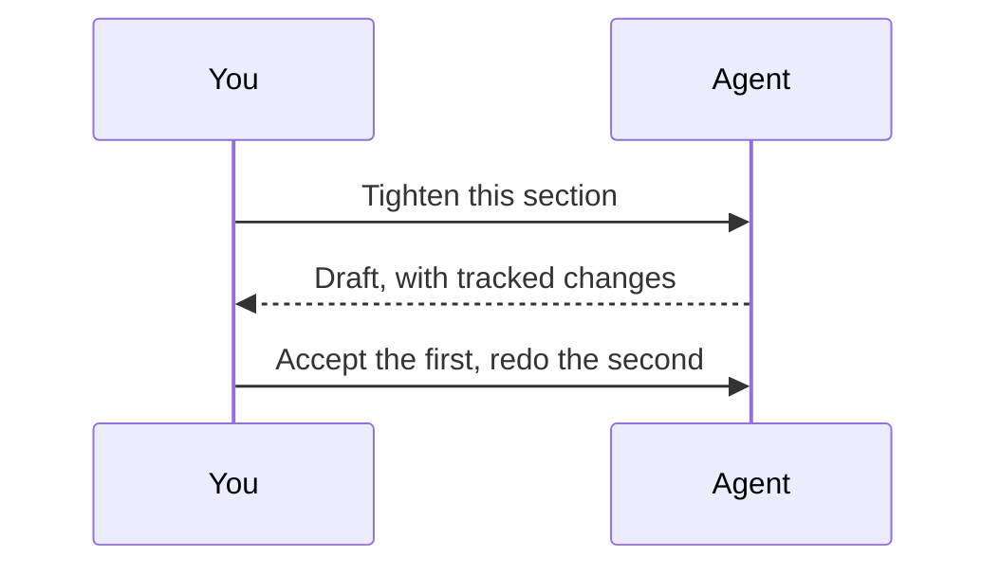
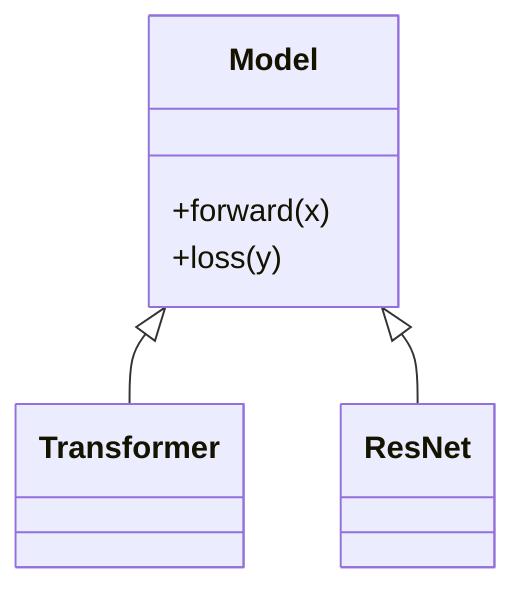
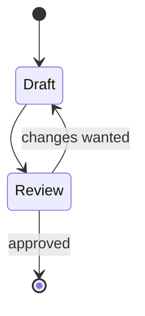
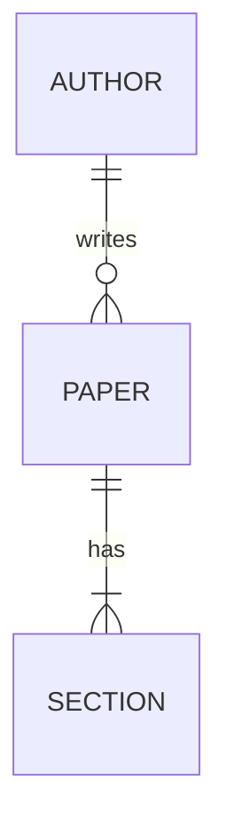
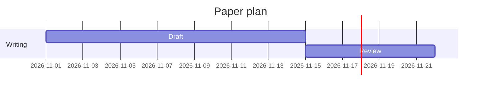
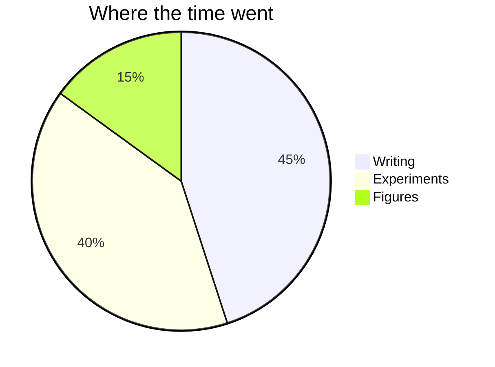
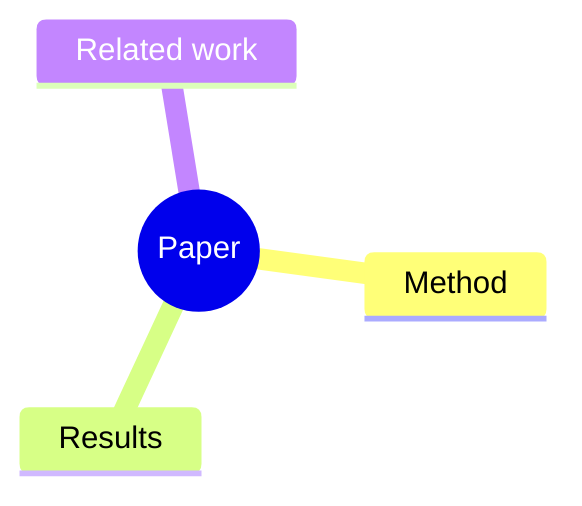
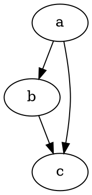

# Everything a page can do

Click anywhere and type. This file is yours to break: nothing here is precious. Each section says what to **try**, so you can use it as a checklist.

> [!TIP]
> Open the Agents icon at the top right and start an agent beside this page, then select any words here. **Comment** and **Ask Agent** appear next to them.

## Text

Plain words, **bold**, *italic*, ***both***, ~~struck out~~, `inline code`, ==highlighted==, H~2~O and E = mc^2^. A [link to Example](https://example.com) opens in the side pane with Ctrl+click.

Try: select a word and use the bar at the top, or right-click it.

### Lists

- A bullet
  - Nested under it
    - And again
- Press Enter at the end of this one to continue the list

1. First
2. Second
3. Press Enter here too

- [x] A finished task: click its box
- [ ] One still to do

> A plain quote. Long quotes wrap the way any paragraph does, keeping their bar beside them from the first line to the last.

## Callouts

> [!NOTE]
> Worth knowing.

> [!IMPORTANT]
> Needed for this to work.

> [!WARNING]
> Careful with this.

> [!CAUTION]
> This can lose work.

## Tables

Right-click a cell for rows, columns and alignment. Click any cell to type, even an empty one, and Tab moves to the next.

| Model     | Dataset  | Accuracy | Params |
|:----------|:--------:|---------:|-------:|
| Baseline  | CIFAR-10 |     91.2 |   1.2M |
| Attention | CIFAR-10 |     94.8 |   1.4M |
| Attention | ImageNet |          |        |

Try: use the table button in the bar to add a new one with a size picker.

## Math

Inline math sits in the line, as $\alpha_{ij} = \frac{\exp(s_{ij})}{\sum_k \exp(s_{ik})}$ does. Click it to edit its source, with the result in view. The formula button in the bar has a searchable list of symbols.

$$
\mathcal{L}(\theta) = \mathbb{E}_{x \sim p}\bigl[\ell(f_\theta(x))\bigr] + \lambda \|\theta\|_2^2
$$

Aligned equations, numbers, matrices and cases:

$$
\begin{align}
\theta_{t+1} &= \theta_t - \eta \nabla \mathcal{L}(\theta_t) \tag{1} \\
\hat\theta &= \argmin_{\theta \in \mathbb{R}^d} \mathcal{L}(\theta) \tag{2}
\end{align}
$$

$$
A = \begin{bmatrix} 1 & 0 \\ 0 & \lambda \end{bmatrix},
\quad
\eta_t = \begin{cases} \eta_0 & t < T_0 \\ \eta_0 / \sqrt{t} & \text{otherwise} \end{cases}
$$

## Pictures

Hover one: a handle on its right edge resizes it, and a Comment button asks about it. Right-click for Small, Medium, Large, Full Width, Replace and Delete. Drop a file on the page, or paste one with the picture button.

{width=60%}


## Diagrams

Click a diagram to edit its source, with the picture under it. If you break it, the last good picture stays and it tells you why. The diagram button in the bar has a template for each.

















Graphviz:



TikZ, built by your LaTeX engine in the background, with a note while it works:

```tikz
\draw[->] (0,0) -- (3,0) node[right] {$x$};
\draw[->] (0,0) -- (0,2) node[above] {$y$};
\draw[thick, blue] (0,0) .. controls (1,2) and (2,0) .. (3,1.5);
```

SVG, written right here:

```svg
<svg xmlns="http://www.w3.org/2000/svg" width="200" height="60">
  <rect width="200" height="60" rx="10" fill="#dcfce7"/>
  <text x="100" y="37" text-anchor="middle" font-size="18" fill="#166534">Inline SVG</text>
</svg>
```

## Code

```python
import torch

def attention(q, k, v):
    weights = torch.softmax(q @ k.transpose(-2, -1), dim=-1)
    return weights @ v
```

```rust
fn main() {
    println!("hello");
}
```

## Footnotes

A claim that needs a source[^source], and a second one[^more]. Numbers follow the order they're cited.

[^source]: The note itself, in smaller type, at the place you wrote it.
[^more]: Footnotes reach the PDF as real footnotes.

## Track changes

Press the pencil in the bar, or run Toggle Track Changes, then type: your edits stay as suggestions. Right-click one to accept or reject it, or settle them all from the commands.

The model {++clearly ++}improves on the baseline{-- by a wide margin--}, and {~~tests~>experiments~~} show it holds at scale.{>>A note for a reviewer.<<}

## Spelling and grammar

These words are wrong on purpose: this sentance has a mispelled word, and this are a grammar mistake. Right-click an underlined word for fixes, or Add to Dictionary.

## Comments with an agent

1. Start an agent from the Agents icon at the top right.
2. Select words here and press **Ask Agent**.
3. Write your question and press Enter.
4. Its answer lands under your comment in the side pane.

---

## Export

- The download button in the bar makes a PDF, with diagrams and footnotes.
- It can also open this page in a real browser inside the side pane.
- The **Outline** icon on the left shows these headings. Click one to go there.
